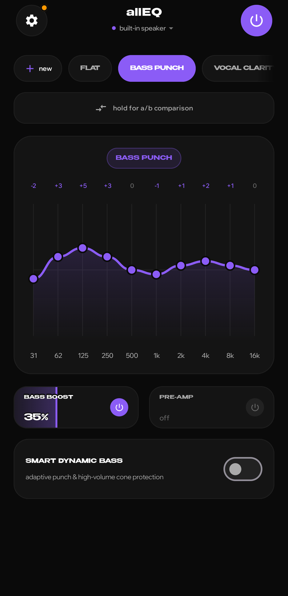
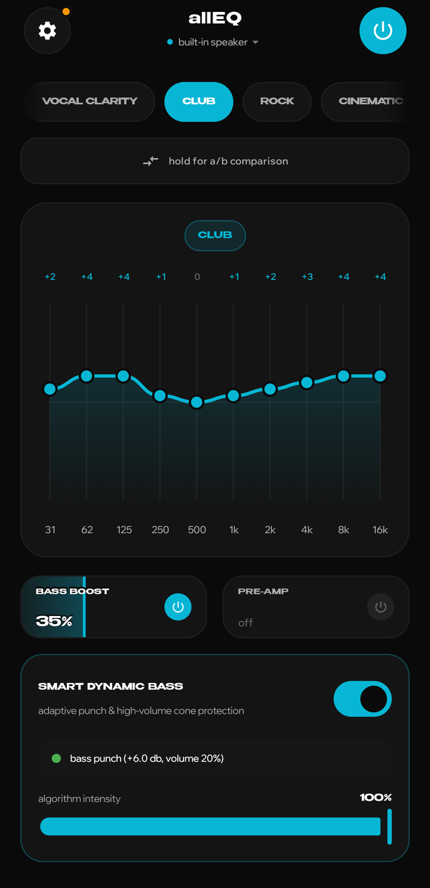
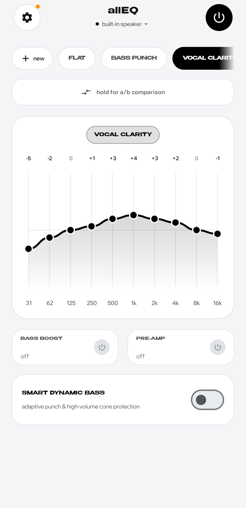

<div align="center">


# allEQ

**System-wide 10-band equalizer for Android. No root, no ads, fully offline.**

[](https://github.com/omixin/allEQ/releases)
[](https://t.me/allEQoff)
[-blue.svg?style=flat-square)](https://developer.android.com)
[](https://shizuku.rikka.app)
[](#android-auto)

[](LICENSE)
[](https://app.lava.top/products/1cfd8c11-bf9c-4198-9fcb-7df7b97de1e9)

[**English**](README.md) • [**Русский**](README_RU.md) • [**Telegram Chat**](https://t.me/allEQoff)

</div>

> **Telegram Community:** Join discussions, beta testing, and presets sharing in our official Telegram chat — [**@allEQoff**](https://t.me/allEQoff).

---

## What It Is

allEQ is a system-wide equalizer for Android that works without root. One curve applies to everything you play: music apps, YouTube, games. It works on the phone speaker, wired and Bluetooth headphones, USB DACs, and follows your music into **Android Auto**.

[Shizuku](https://shizuku.rikka.app) is used for one thing: keeping allEQ alive on phones that kill background apps.

---

## Why I Made It

I wanted a proper EQ on my phone without root, ads or subscriptions, and couldn't find one. ViPER4Android needs root, which breaks banking apps. Most rootless EQs get killed by the battery saver after a few minutes, or just push the bass until the phone's amp protection squashes the volume and voices turn to mud.

So allEQ:

* hooks the global output mix (`Session 0`) with Android's own `AudioEffect`s, no root needed;
* asks Shizuku to whitelist it from OEM battery killers (MIUI, HyperOS, One UI, OriginOS), so it doesn't silently stop;
* keeps voices clear when you boost the bass: a small lift on 800–3000 Hz and a -1.5 dBFS limiter;
* has no internet permission at all. No ads, analytics or trackers.

Built with Kotlin and Jetpack Compose. Package: `com.omix.alleq`.

---

## Screenshots

<div align="center">

| Equalizer | Smart Dynamic Bass | Light Theme | Settings |
|:---:|:---:|:---:|:---:|
|  |  |  |  |
| *10-band curve, Bass Punch* | *Club preset, bass follows volume* | *Vocal Clarity, follows system theme* | *Presets, scale and accents* |

</div>

---

## Key Features

### Audio DSP Engine
* **10-Band Graphic Equalizer:** Studio-calibrated frequency bands (31 Hz, 62 Hz, 125 Hz, 250 Hz, 500 Hz, 1 kHz, 2 kHz, 4 kHz, 8 kHz, 16 kHz) with smooth cubic Bézier curve visualization, magnetic 0 dB snapping and tap-to-reset.
* **Tactile Capsule Faders:** Vertical swipeable faders for **Bass Boost** (0–100%) and **Pre-Amp** (-12 dB to +12 dB) with haptic feedback steps. Negative pre-amp is real attenuation, handy for taming hot masters or heavy boosts.
* **Honest Flat:** A flat curve with 0 dB pre-amp leaves the signal untouched. Makeup gain is only added for boosts you actually dial in.
* **Smart Dynamic Bass:** Volume-adaptive mid-bass punch at lower volumes with high-volume cone excursion protection to eliminate speaker distortion. It lifts the bass only and never raises the whole mix.
* **Always-On Safety Limiter:** A -1.5 dBFS brickwall stage after all gain stages prevents digital clipping on any preset.
* **Instant A/B Bypass:** Hold the comparison button to temporarily bypass all DSP processing and compare directly with the uncolored sound.

### Interface & Theming
* **Expressive Studio UI:** Benzin bold headers and Wix Madefor Display body typography inspired by studio mixing consoles.
* **Color Accents:** Emerald Green, Electric Cyan, Vivid Orange, Studio Purple, System Material You, or Custom Hex Accent.
* **UI Scaling:** Three density presets (Compact 85%, Standard 100%, Large 115%) ensuring comfortable hitboxes on both compact phones and large displays.
* **Preset Manager:** Create, reorder with drag-and-drop (`☰`), delete, and restore built-in or custom presets.

### Android Auto
* **EQ in the car:** Processing follows the player's audio stream to the head unit while Android Auto is connected.
* **Preset screen on the car display:** Switch presets and toggle allEQ right from the Android Auto launcher.
* **Car-friendly gain staging:** Makeup gain is disabled on Android Auto, since the head unit has its own amplifier stage.

### System Integration
* **Per-Device Presets:** allEQ remembers a preset for each output (speaker, headphones, Bluetooth devices, Android Auto) and switches automatically.
* **Home Screen Widgets & Quick Settings Tile:** 2x1, 2x2 and 4x1 widgets plus a tile for one-tap control.
* **Autostart After Reboot:** The service comes back after a restart if it was enabled. On Android 15, where the system may refuse a background start, a notification lets you resume with one tap.
* **OEM Whitelist Integration:** Automated background battery-saving whitelist via Shizuku shell.
* **100% Offline:** No internet permissions declared in `AndroidManifest.xml`.

---

## Requirements

| Requirement | Specification |
|:---|:---|
| **Android Version** | Android 10.0 (API 29) or higher |
| **Root Required** | **No** (Rootless) |
| **Privilege Provider** | [Shizuku](https://shizuku.rikka.app) (Running via Wireless Debugging or ADB) |
| **Supported Devices** | Samsung, Xiaomi/Redmi, Vivo/iQOO, OnePlus, Google Pixel, Motorola, etc. |

---

## Quick Setup Guide

1. Install and start [Shizuku](https://shizuku.rikka.app) on your device (via Wireless Debugging or USB ADB from a PC).
2. Download and install the latest `allEQ-*.apk` from [Releases](https://github.com/omixin/allEQ/releases).
3. Launch allEQ and grant Shizuku permissions when prompted.
4. Tap the power button to activate system-wide equalization!

---

## Android Auto

Android Auto only lists apps installed from Google Play unless unknown sources are allowed. Since allEQ is distributed via GitHub, enable this once:

1. Open **Android Auto settings** on the phone (Settings > Connected devices > Android Auto, or the Android Auto app).
2. Tap the **Version** entry about 10 times to unlock developer mode, then confirm.
3. Open the overflow menu (three dots) > **Developer settings** and enable **Unknown sources**.
4. Reconnect to the car. allEQ now appears in the Android Auto launcher.

### allEQ does not show up in the car

Newer Android Auto versions (17.8 and later) may still hide allEQ even with **Unknown sources** enabled, because the unknown sources switch does not cover car apps like allEQ's preset screen. The workaround is to install allEQ so that Android Auto sees Google Play as its installer. You already have Shizuku running, so this takes a minute:

1. Install **KingInstaller** and grant it Shizuku access.
2. In KingInstaller, select the **Shizuku** install mode and set the installer to **Google Play** (`com.android.vending`).
3. Install the allEQ APK through KingInstaller (on top of the existing install, settings are kept).
4. On the phone, open Android Auto settings > **Customize launcher** and enable allEQ, then reconnect to the car.

Install every allEQ update the same way, otherwise Android Auto hides it again. Tested on a real car with Android Auto 18.

Another option is [AAEnabler](https://github.com/malebuffy/AAEnabler): pick the allEQ APK in it and install, then enable allEQ in the launcher settings as above. Suggested by a user, I haven't tested it myself.

EQ in the car works with players that announce their audio session to equalizers (Spotify, YouTube Music, Poweramp and most dedicated music players). If a player was started before allEQ, restart playback once so allEQ can pick up its session.

---

## Known Limitations

* **Phones without DynamicsProcessing:** since 1.3 the 10-band curve runs on Android's DynamicsProcessing, so all 10 bands work even where the hardware equalizer has only 5. If a phone's firmware doesn't provide it, allEQ falls back to the hardware equalizer and the curve is mapped to its bands (often 5).
* **Exclusive DSP apps:** Other equalizers (Wavelet, Poweramp EQ, OEM sound effects) can take exclusive control of the output mix. Disable them when using allEQ.
* **Android Auto players:** Apps that do not announce an audio session (some browsers and games) are not processed in the car.

---

## Building from Source

### Prerequisites
* JDK 17
* Android SDK 35 (Platform tools & build tools)
* Gradle 8.11+ / AGP 9.2+

### Clone & Build
```bash
# Clone the repository
git clone https://github.com/omixin/allEQ.git
cd allEQ

# Build debug APK
./gradlew assembleDebug

# Build optimized release APK
./gradlew assembleRelease
```

The output signed APK will be located at:
`app/build/outputs/apk/release/app-release.apk`

---

## Support

allEQ is free, has no ads and never will. If it made your music sound better, you can leave a one-time tip on [**lava.top**](https://app.lava.top/products/1cfd8c11-bf9c-4198-9fcb-7df7b97de1e9). It does not unlock anything in the app, it just keeps updates coming.

---

## License

`allEQ` is distributed under the terms of the **GNU General Public License v3.0 (GPL-3.0)**.  
See the [LICENSE](LICENSE) file for the full license text.

---

<div align="center">
Developed with passion by <b><a href="https://github.com/omixin">@omixin</a></b>
</div>
