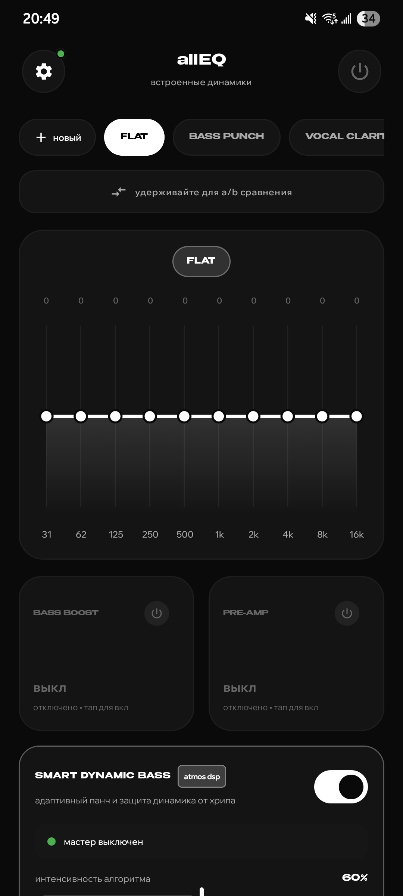
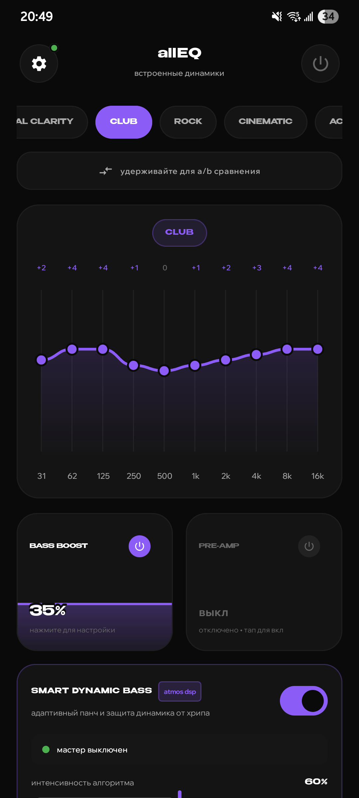
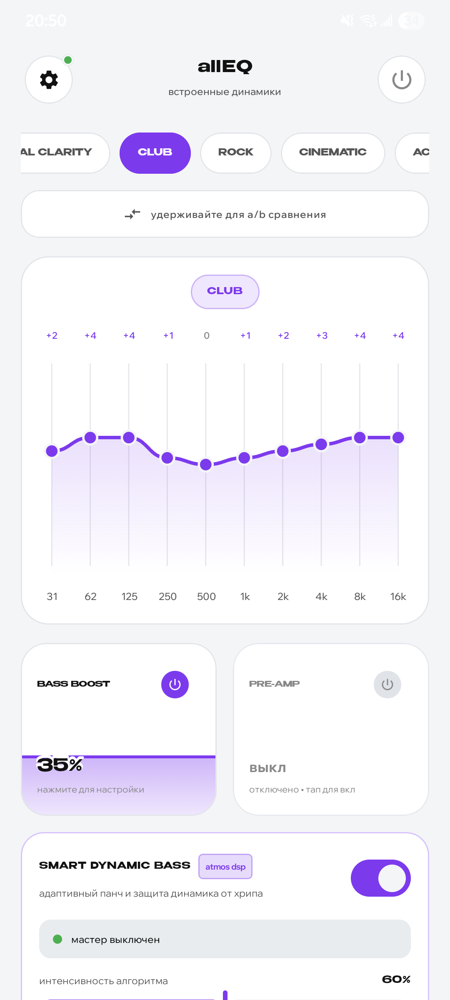
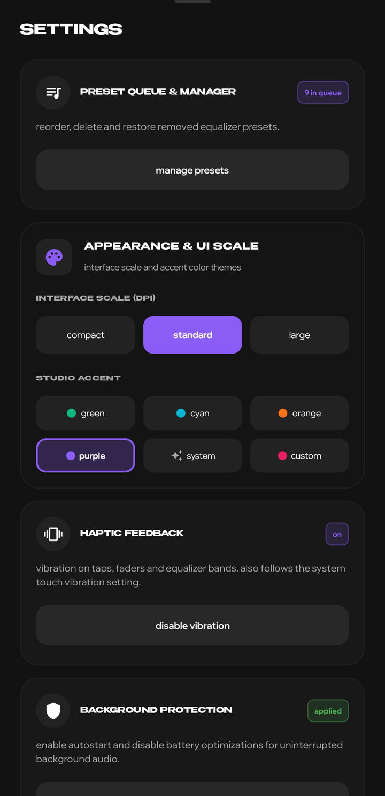

<div align="center">


# allEQ

**Rootless 10-band system equalizer for Android with Smart Dynamic Bass and tactile mixing controls.**

[](https://github.com/omixin/allEQ/releases)
[](https://t.me/allEQoff)
[-blue.svg?style=flat-square)](https://developer.android.com)
[](https://shizuku.rikka.app)
[](#android-auto)

[](LICENSE)

[**English**](README.md) • [**Русский**](README_RU.md) • [**Telegram Chat**](https://t.me/allEQoff)

</div>

> **Telegram Community:** Join discussions, beta testing, and presets sharing in our official Telegram chat — [**@allEQoff**](https://t.me/allEQoff).

---

## What It Is

**allEQ** is an open-source, rootless system-wide audio equalizer for Android built with modern Jetpack Compose and powered by [Shizuku](https://shizuku.rikka.app).

It attaches to the global output mix (`Session 0`) to provide low-latency, system-wide acoustic correction for built-in speakers, wired headphones, Bluetooth headsets and external USB DACs, and follows your music into **Android Auto**.

* **Package name:** `com.omix.alleq`
* **Maintainer:** [@omixin](https://github.com/omixin)
* **Architecture:** 100% Kotlin, Jetpack Compose, Material 3, Android DynamicsProcessing & AudioEffects API

---

## Why This Exists

Most existing equalizer applications on Android face one of three fundamental problems:

1. **Root requirement:** Advanced DSP tools (such as ViPER4Android) require Magisk/KernelSU root, tripping SafetyNet/Play Integrity and making banking apps inaccessible.
2. **Aggressive background killing:** Non-root equalizers often rely on `NotificationListenerService` or accessibility hacks. Aggressive OEM task killers (MIUI, HyperOS, OneUI, OriginOS) terminate them within minutes of audio playback.
3. **Muffled vocals during bass boost:** Traditional equalizers simply boost lower frequencies, causing the phone's hardware amplifier protection to squash master volume and muffling speech and dialogue in videos.
4. **Bloat and trackers:** Commercial equalizers frequently package invasive analytics, full-screen advertisements, and subscription paywalls.

**allEQ was built to solve these problems directly:**

* **Rootless Session 0 Hook:** Attaches native `AudioEffect`s to the global output mix (`AUDIO_SESSION_OUTPUT_MIX`), applying EQ across all applications without root. Shizuku is used to whitelist the service from OEM battery killers, so processing never silently stops.
* **Smart Dynamic Bass & Vocal Protection:** An always-on brickwall limiter (-1.5 dBFS) and dynamic mid-frequency compensation (up to +2 dB on 800–3000 Hz) keep speech in podcasts, TikTok and YouTube intelligible when sub-bass is boosted.
* **100% Offline & Private:** The app has zero network permissions (`android.permission.INTERNET` is not declared). Zero analytics, zero telemetry, zero trackers.
* **Zero Passive Battery Drain:** Operates via native Audio HAL effects without maintaining continuous CPU wake-locks or audio re-encoding pipelines.

---

## Screenshots

<div align="center">

| System Equalizer | Club Preset & Bass | Light Theme | Settings & Theming |
|:---:|:---:|:---:|:---:|
|  |  |  |  |
| *10-band precision faders* | *Purple accent with CLUB curve* | *Clean high-contrast daylight UI* | *Scale, colors & Shizuku status* |

</div>

---

## Key Features

### Audio DSP Engine
* **10-Band Graphic Equalizer:** Studio-calibrated frequency bands (31 Hz, 62 Hz, 125 Hz, 250 Hz, 500 Hz, 1 kHz, 2 kHz, 4 kHz, 8 kHz, 16 kHz) with smooth cubic Bézier curve visualization, magnetic 0 dB snapping and tap-to-reset.
* **Tactile Capsule Faders:** Vertical swipeable faders for **Bass Boost** (0–100%) and **Pre-Amp** (-12 dB to +12 dB) with haptic feedback steps. Negative pre-amp is real attenuation, handy for taming hot masters or heavy boosts.
* **Honest Flat:** A flat curve with 0 dB pre-amp leaves the signal untouched. Makeup gain is only added for boosts you actually dial in.
* **Smart Dynamic Bass:** Volume-adaptive mid-bass punch at lower volumes with high-volume cone excursion protection to eliminate speaker distortion. It lifts the bass only and never raises the whole mix.
* **Always-On Safety Limiter:** A -1.5 dBFS brickwall stage after all gain stages prevents digital clipping on any preset.
* **Instant A/B Bypass:** Hold the comparison button to temporarily bypass all DSP processing and compare directly with the uncolored sound.

### Interface & Theming
* **Expressive Studio UI:** Benzin bold headers and Wix Madefor Display body typography inspired by studio mixing consoles.
* **Color Accents:** Emerald Green, Electric Cyan, Vivid Orange, Studio Purple, System Material You, or Custom Hex Accent.
* **UI Scaling:** Three density presets (Compact 85%, Standard 100%, Large 115%) ensuring comfortable hitboxes on both compact phones and large displays.
* **Preset Manager:** Create, reorder with drag-and-drop (`☰`), delete, and restore built-in or custom presets.

### Android Auto
* **EQ in the car:** Processing follows the player's audio stream to the head unit while Android Auto is connected.
* **Preset screen on the car display:** Switch presets and toggle allEQ right from the Android Auto launcher.
* **Car-friendly gain staging:** Makeup gain is disabled on Android Auto, since the head unit has its own amplifier stage.

### System Integration
* **Per-Device Presets:** allEQ remembers a preset for each output (speaker, headphones, Bluetooth devices, Android Auto) and switches automatically.
* **Home Screen Widgets & Quick Settings Tile:** 2x1, 2x2 and 4x1 widgets plus a tile for one-tap control.
* **Autostart After Reboot:** The service comes back after a restart if it was enabled. On Android 15, where the system may refuse a background start, a notification lets you resume with one tap.
* **OEM Whitelist Integration:** Automated background battery-saving whitelist via Shizuku shell.
* **100% Offline:** No internet permissions declared in `AndroidManifest.xml`.

---

## Requirements

| Requirement | Specification |
|:---|:---|
| **Android Version** | Android 10.0 (API 29) or higher |
| **Root Required** | **No** (Rootless) |
| **Privilege Provider** | [Shizuku](https://shizuku.rikka.app) (Running via Wireless Debugging or ADB) |
| **Supported Devices** | Samsung, Xiaomi/Redmi, Vivo/iQOO, OnePlus, Google Pixel, Motorola, etc. |

---

## Quick Setup Guide

1. Install and start [Shizuku](https://shizuku.rikka.app) on your device (via Wireless Debugging or USB ADB from a PC).
2. Download and install the latest `allEQ-*.apk` from [Releases](https://github.com/omixin/allEQ/releases).
3. Launch allEQ and grant Shizuku permissions when prompted.
4. Tap the power button to activate system-wide equalization!

---

## Android Auto

Android Auto only lists apps installed from Google Play unless unknown sources are allowed. Since allEQ is distributed via GitHub, enable this once:

1. Open **Android Auto settings** on the phone (Settings > Connected devices > Android Auto, or the Android Auto app).
2. Tap the **Version** entry about 10 times to unlock developer mode, then confirm.
3. Open the overflow menu (three dots) > **Developer settings** and enable **Unknown sources**.
4. Reconnect to the car. allEQ now appears in the Android Auto launcher.

EQ in the car works with players that announce their audio session to equalizers (Spotify, YouTube Music, Poweramp and most dedicated music players). If a player was started before allEQ, restart playback once so allEQ can pick up its session.

---

## Known Limitations

* **Hardware band count:** allEQ drives the device's native equalizer. Many phones expose 5 hardware bands, in which case the 10-band curve is mapped to the nearest hardware bands.
* **Exclusive DSP apps:** Other equalizers (Wavelet, Poweramp EQ, OEM sound effects) can take exclusive control of the output mix. Disable them when using allEQ.
* **Android Auto players:** Apps that do not announce an audio session (some browsers and games) are not processed in the car.

---

## Building from Source

### Prerequisites
* JDK 17
* Android SDK 35 (Platform tools & build tools)
* Gradle 8.11+ / AGP 9.2+

### Clone & Build
```bash
# Clone the repository
git clone https://github.com/omixin/allEQ.git
cd allEQ

# Build debug APK
./gradlew assembleDebug

# Build optimized release APK
./gradlew assembleRelease
```

The output signed APK will be located at:
`app/build/outputs/apk/release/app-release.apk`

---

## License

`allEQ` is distributed under the terms of the **GNU General Public License v3.0 (GPL-3.0)**.  
See the [LICENSE](LICENSE) file for the full license text.

---

<div align="center">
Developed with passion by <b><a href="https://github.com/omixin">@omixin</a></b>
</div>
